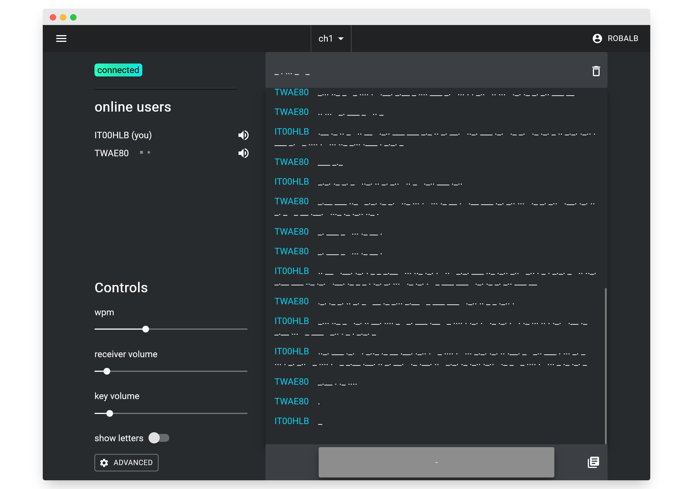
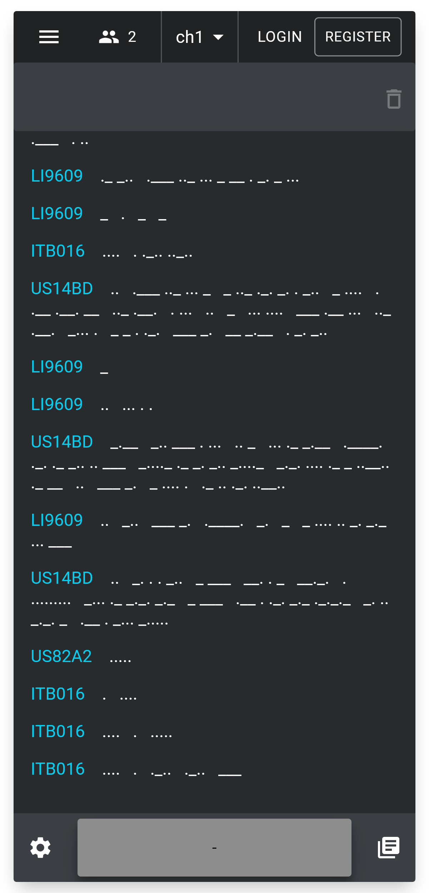

#  Morsechat 

[](https://morse.halb.it)
[](https://morse.halb.it)
[](https://morse.halb.it)

[](https://observatory.mozilla.org/analyze/morse.halb.it)

[](https://discord.gg/JNwsmHuKwd)

An online morse code chat, allowing users from all over the world to practice and communicate in morse code without the need for expensive equipment. Live at [morse.halb.it](https://morse.halb.it/)

## screenshots
<p align="center">


</p>

<!--
w 600 200
h 500 400
-->

## configuration

The backend has no built-in defaults. Every setting must be provided through
its environment variable or the matching command-line flag. When a required
value is missing the server refuses to start and lists everything that is not
configured.

| Environment variable | Flag | Description |
| --- | --- | --- |
| `HOST` | `-host` | Interface to bind, for example `127.0.0.1` or `0.0.0.0` |
| `PORT` | `-port` | API port |
| `SQLITE_PATH` | `-sqlite_path` | Path to the sqlite database |
| `SECRET` | `-secret` | Base64-encoded 32-byte encryption secret |
| `METRICS_ENABLED` | `-metrics_enabled` | `true` or `false` |
| `METRICS_PORT` | `-metrics_port` | Prometheus port, required when metrics are enabled |

Flags take precedence over environment variables, and real environment
variables take precedence over `.env`.

Generate a secret with `cd backend && go run cmd/secrets/main.go`.

For local development, copy `.env.example` to `backend/.env` and set `SECRET`.
The server and the admin command load `backend/.env` automatically when they are
started from `backend/`.

For Docker, copy `.env.example` into `.env` in the repository root and set
`SECRET`; the compose file provides the remaining values and refuses to start
when `SECRET` is empty.


## development

clone this repository `git clone https://github.com/robalb/morsechat.git`

navigate into the repository `cd morsechat`

configure and start the backend:

```bash
cd backend
cp ../.env.example .env

# Generate a secret and copy the value printed after "Secret: " into .env
go run cmd/secrets/main.go

go run -race cmd/morsechat/main.go
```

PowerShell:

```powershell
cd backend
Copy-Item ..\.env.example .env

# Generate a secret and copy the value printed after "Secret: " into .env
go run cmd/secrets/main.go

go run -race cmd/morsechat/main.go
```

The `.env` file is git-ignored. You can also provide the values through the
environment or flags (see the table above); both override the file.

start vite in development mode `cd webapp && npm run dev`

These steps are enough to get a local version of the app running.
The backend also includes unit, e2e, and fuzz tests, which you can run with the command `go test ./...`

### administrators

Administrators are stored in the database (`users.is_admin`), not in
environment variables, so that a leaked or mistyped variable can never grant
admin rights. Promote an existing account with the admin bootstrap command:

```bash
cd backend
go run cmd/admin/main.go -username <username> -sqlite_path db.sqlite
```

The database path must be configured explicitly. Either pass `-sqlite_path` or
set `SQLITE_PATH` to the same value used by the server; the flag takes
precedence:

```bash
cd backend
export SQLITE_PATH=db.sqlite
go run cmd/admin/main.go -username <username>
```

PowerShell:

```powershell
cd backend
$env:SQLITE_PATH = "db.sqlite"
go run cmd/admin/main.go -username <username>
```

The command never guesses a database path. If neither the flag nor the
environment variable is set, it exits with an error instead of opening (and
possibly creating) the wrong database. When run from `backend/`, the command
reads `backend/.env`, so the `SQLITE_PATH` defined there is used automatically.

Use `-revoke` to remove the role again. In a container, the bundled binary
already receives `SQLITE_PATH` from the compose environment:

```bash
docker compose exec morse /app/backend/morsechat-admin -username <username>
```

Role changes take effect immediately: the API re-checks the database on every
moderator and admin request.

## production

The easiest way to run the webapp in a production environment is with the provided docker-compose.yml,
`docker-compose up --build`


Alternatively you can deploy the app on a k8s kluster using the manifests in `kubernetes/base` but first you will need to
setup on your own a traefik ingress controller and certmanager.
The backend webserver is configured to handle X-Forwarder-For headers coming from an ingress with proxy protocol enabled.
You can configure it in flaskapp.conf

The live website on halb.it is built using github workflows, and deployed on a k8s cluster with argoCD

